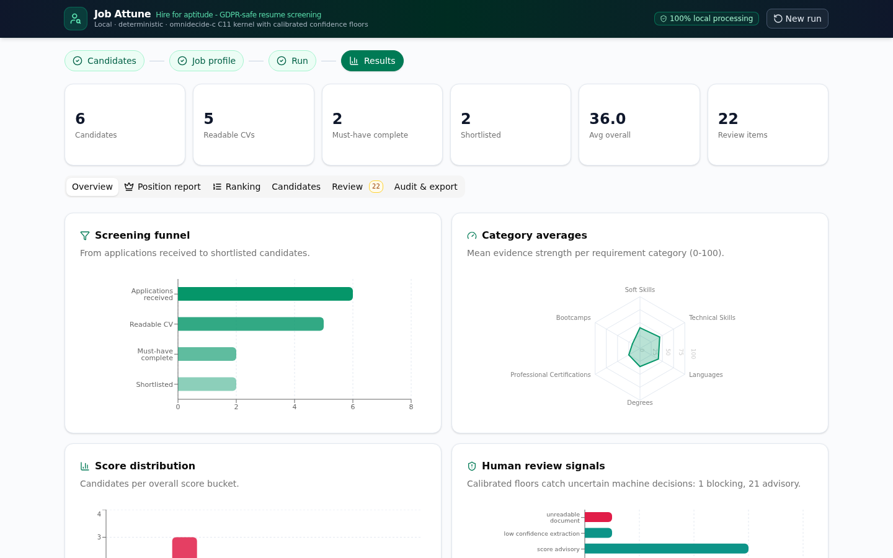
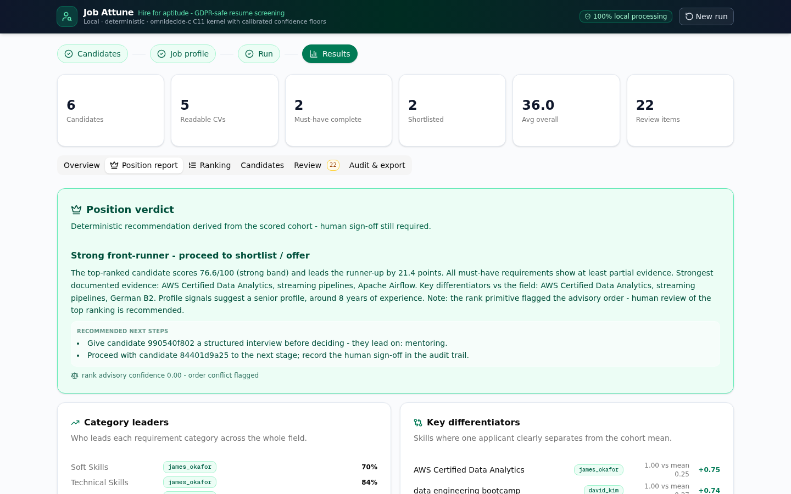
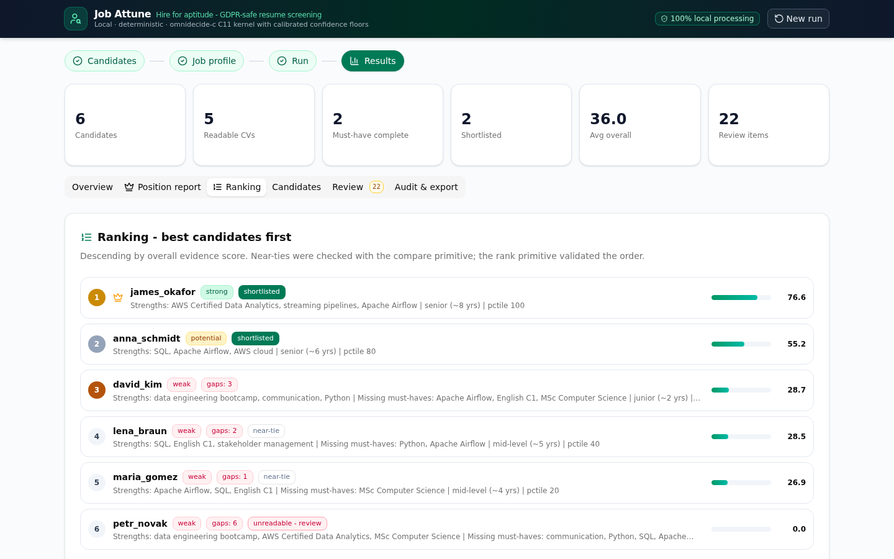
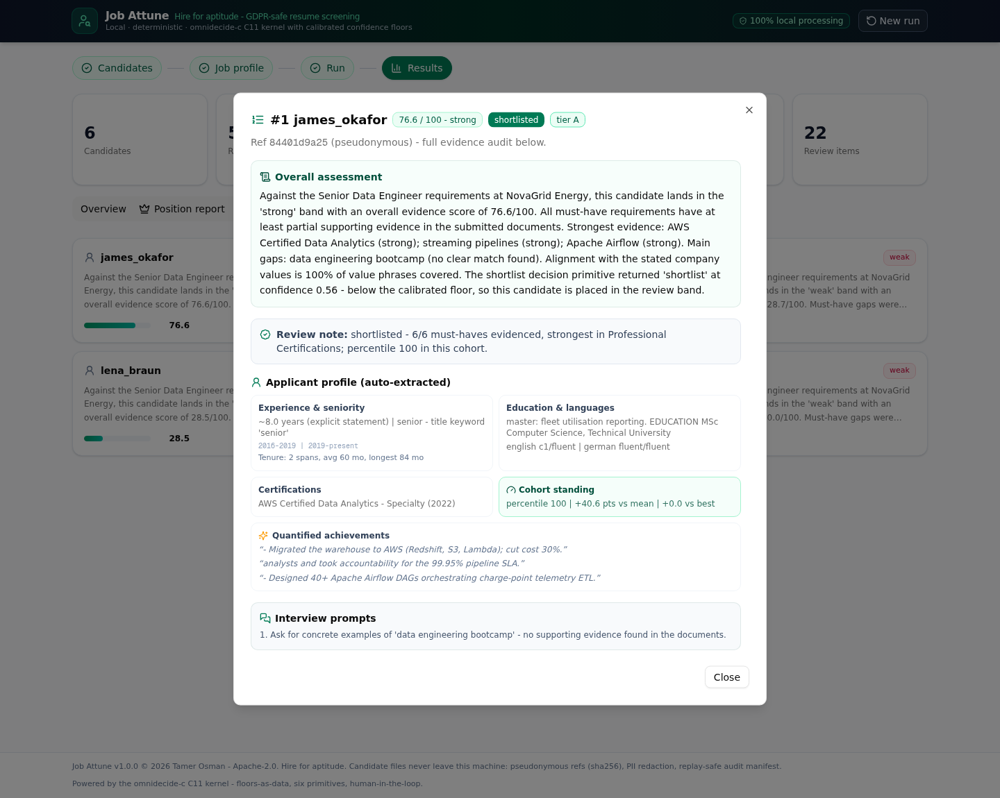
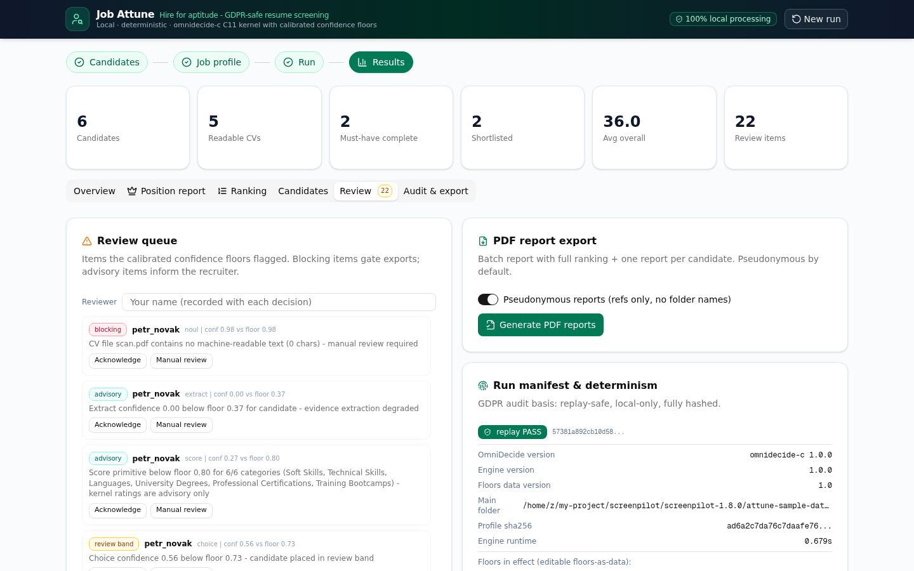

<!-- SPDX-License-Identifier: Apache-2.0 -->
<!-- SPDX-FileCopyrightText: 2026 Tamer Osman -->

<p align="center">
  
</p>

<h1 align="center">Job Attune</h1>

<h3 align="center">Hire for aptitude.</h3>

<p align="center">
  <strong>GDPR-safe, local-first resume screening.</strong><br/>
  A deterministic engine that turns a folder of applicant PDFs into a ranked,
  fully auditable shortlist — with pseudonymous reports and a reproducible
  decision manifest for every run.
</p>

<p align="center">
  <a href="LICENSE"></a>
  <a href="CHANGELOG.md"></a>
  <a href="vendor/omnidecide-c/README.md"></a>
  <a href="CHANGELOG.md"></a>
  <br/>
  <a href="docs/VERIFICATION-1.8.0.md"></a>
  <a href="docs/ARCHITECTURE.md"></a>
  <a href="scripts/check_python_side.py"></a>
  <a href="docs/ENGINE-CLI.md"></a>
</p>

<p align="center"><sub>
  <a href="#why-job-attune">Why</a> ·
  <a href="#screenshots">Screenshots</a> ·
  <a href="#features">Features</a> ·
  <a href="#how-it-works">How it works</a> ·
  <a href="#measured-accuracy">Accuracy</a> ·
  <a href="#receipts-not-promises">Receipts</a> ·
  <a href="#quickstart">Quickstart</a> ·
  <a href="#documentation">Docs</a> ·
  <a href="#faq">FAQ</a> ·
  <a href="#license">License</a>
</sub></p>

<p align="center">
  
</p>

<p align="center"><sub>No cloud · No accounts · No API keys · No model calls — one command, then it runs on your machine.</sub></p>

---

## Why Job Attune?

*at·tune (v.) — bring into accord; bring into harmony.*

Resume screening software is broken in two familiar ways. Keyword ATS
filters punish aptitude: one missing keyword vetoes a strong candidate, and
the best person for the role never reaches a human. Cloud "AI" screeners fix
the rigidity but introduce a worse trade: opaque scores you cannot explain in
an audit, different answers for the same CV, and candidate files leaving your
machine for someone else's model.

Job Attune is the third way. **Deterministic math instead of keywords; evidence
instead of vibes; humans keep the last word.** The same folder of CVs produces
the same ranking every single time — byte for byte — and every score carries
the CV evidence that produced it. The engine never auto-rejects anything:
whatever it cannot read confidently escalates to a human review queue. And
there is no cloud, no account and no API key anywhere in the pipeline: the
decision kernel is a pure C11 computation library with no network code, so
there is no data-egress path to audit away.

| What matters in screening | Keyword ATS | LLM screener | Job Attune |
|---|:---:|:---:|:---:|
| Same inputs → same ranking, every time | ❌ | ❌ | ✅ |
| Every score backed by quoted CV evidence | ❌ | ⚠️ unverifiable | ✅ |
| Candidate files stay on your machine | ⚠️ varies | ❌ usually cloud | ✅ always |
| Decisions you can defend in an audit | ❌ | ⚠️ | ✅ |
| Runs air-gapped — no keys, no metering | ⚠️ rare | ❌ | ✅ |
| Unclear cases escalate to a human | ⚠️ | ⚠️ | ✅ always |

## Screenshots

All screenshots come from a **real run of the shipped demo corpus**
(`attune-sample-data/candidates` — 6 candidates / 10 PDFs, ranked in 0.8 s)
against the `example-senior-data-engineer` job profile. This is the exact run
the 45-check QA gate replays on every release, not a mockup.

| | |
|---|---|
|  |  |
| *Overview: cohort statistics, score histogram, category averages* | *Position report: verdict, head-to-head, differentiators* |
|  |  |
| *Ranking board: banded scores with must-have flags* | *Candidate dossier: evidence-backed requirements and profile card* |



*Review queue: low-confidence extractions, unreadable documents and rank
conflicts wait for human sign-off — the engine never auto-rejects.*

## Features

| | |
|---|---|
| **Deterministic replay** — identical inputs produce byte-identical results *and* PDFs; a two-pass sha256 equality check runs on every single run, not just in tests. | **Evidence-first scoring** — every requirement score carries the CV evidence that produced it, so a ranking is never a black box. |
| **Calibrated confidence floors** — all six decision primitives (extract, score, rank, compare, choice, noul) stay load-bearing behind the floors contract (floors v1.0), tuned on pre-registered corpora. | **Escalation-first review queue** — low-confidence extractions, unreadable documents and rank conflicts land in an append-only queue with human sign-off; the engine never auto-rejects. |
| **Pseudonymous by default** — candidates are sha256 refs in every output; PII-redaction probes run on every regression pass. | **Local-only by design** — the UI binds to `127.0.0.1`, its APIs are CSRF/rebinding-guarded, and the kernel contains no network code — there is no egress path. |
| **Ten language packs** — `und en zh hi es ar fr bn pt id ur`, opt-in via `ATTUNE_LANGUAGE`; every run manifest records the effective language for auditability. | **Reproducible PDF reports** — batch report + per-candidate dossiers with a sha256 manifest, pinned reference year, canonical JSON. |
| **Air-gap engine-only mode** — no UI needed: stdlib-only Python over the vendored C11 kernel runs anywhere Python does. | **Tunable, never silent** — aggregation forms (`uniform` / `req_share` / `global`) and the zero-evidence weight are opt-in profile keys with fail-fast validation; every run records its exact math in a provenance block. |

## How it works

<p align="center">
  
</p>

The pipeline in four moves:

1. **Scan & classify.** Point Job Attune at a folder of applicant PDFs (one
   subfolder per candidate). Every document is tagged CV or cover letter
   (filename aliases, EN + DE), and raw text is never persisted.
2. **Score with evidence.** Extraction → evidence scoring → aggregation →
   ranking runs on the [omnidecide-c 1.0.0](vendor/omnidecide-c/) C11
   decision kernel (the only kernel), gated by the calibrated
   [floors contract](attune-engine/floors.py). Candidates are pseudonymous
   refs throughout.
3. **Escalate what is unclear.** The `noul` primitive routes low-confidence
   extractions, unreadable files and rank conflicts into the review queue
   instead of guessing — an audit-friendly definition of "I don't know."
4. **Report & archive.** A batch report, per-candidate dossiers and a
   `results.json` with a full provenance block land in the run directory; the
   manifest pins the engine, kernel and floors versions that produced them.

Component-level detail, data contracts, the redaction pipeline and the
security model live in [docs/ARCHITECTURE.md](docs/ARCHITECTURE.md).

## Measured accuracy

Spearman rho against **pre-registered, frozen human rankings**, candidate-blind
bench, study salt `task32-study` (full protocol in
[bench/README.md](bench/README.md)):

| System | corpus20 (synthetic) | real40 (authentic CVs) | logistics14 | trades14 |
|---|---|---|---|---|
| **Job Attune engine** | **0.931** | **0.640** | 0.802 | 0.877 |
| BM25 | 0.917 | 0.574 | 0.837 | 0.912 |
| TF-IDF | 0.848 | 0.444 | 0.802 | 0.939 |
| Boolean ATS (keyword veto) | 0.725 | 0.510 | 0.657 | 0.152 |

Honest reading: the engine leads every system on the real-CV corpora
(corpus20 +0.014..+0.206 rho, real40 +0.066..+0.196). On the synthetic
gate-heavy holdout cells the coverage-sum rubric favours veto-free TF-IDF/BM25
— reported openly, because hiring decisions should rest on the full picture.
All twelve recorded cells are deterministic across double passes.

The same rigor holds across languages: on the ten-language reference corpus
(`en zh hi es ar fr bn pt id ur`) the engine scores Spearman rho 0.833–0.929
(mean 0.888) and puts the rank-1 candidate first in all ten languages.

<p align="center">
  
</p>

## Receipts, not promises

Every claim above is a command or a document you can check — no trust
required.

| Claim | How it is proven | Verify it yourself |
|---|---|---|
| Identical inputs → byte-identical outputs | Two-pass sha256 equality enforced on every run; PDFs render through a pinned, invariant ReportLab config | `python3 scripts/check_python_side.py` (45 checks; exit 0 = release-ready) |
| Scoring is stable across releases | 3-case regression lock against the frozen reference scoring lineage | Protocol in [docs/DEVELOPMENT.md](docs/DEVELOPMENT.md) |
| The C11 kernel changes no scores | 36-case kernel A/B battery + full-engine leaf-identical replay | [docs/VERIFICATION-1.8.0.md](docs/VERIFICATION-1.8.0.md) |
| No PII leaks into outputs | PII-redaction probes over all enriched outputs on every regression run | Probe lines in the 45-check gate output |
| Benchmarks are candidate-blind & pre-registered | Frozen corpora, pinned human rankings, recorded study salt | [bench/README.md](bench/README.md) |
| Nothing phones home | The kernel is pure C11 computation — no sockets, no HTTP; the UI binds to `127.0.0.1` only | Read it: [vendor/omnidecide-c/](vendor/omnidecide-c/) |
| Every decision is attributable | Each run manifest records engine, kernel and floors versions plus the aggregation provenance block | Open any run directory under `attune-data/runs/` |

Release discipline follows the same rule: scoring behaviour changes require a
green gate, a green regression lock (or a documented allowlist amendment) and
a CHANGELOG entry — engine and UI are tracked together under the engine
version, so historical runs stay attributable forever.

## Quickstart

**Prebuilt standalone** (nothing to install - recommended for end users):

Download the archive for your OS from
[Releases](https://github.com/tamer4osman/job-attune/releases)
(`job-attune-standalone-<platform>.zip` / `.tar.gz`), verify it against
the shipped `.sha256`, unpack, and run:

- **Windows** (10+, x64) — double-click `start.bat`
- **macOS** (12+, Apple Silicon) — double-click `start.command`
- **Linux** (glibc 2.28+, x64) — run `./start.sh`

Each bundle carries the compiled C11 kernel, the app, and its own Node.js
22 + CPython 3.12 runtimes — the unpacked archive runs offline with no
tooling on the machine.

**With the UI** (Next.js + local engine):

```bash
pip install -r requirements.txt   # reportlab + pypdf (engine: stdlib only)
bun install                       # or: npm install
bun run dev                       # -> http://localhost:3000
```

Then: enter `attune-sample-data/candidates` in the folder picker, **Scan**,
confirm the CV / cover-letter tags, and **Start run**. PDF exports land in
`attune-data/runs/<run-id>/exports/`.

**With Docker** (no local Python/Bun setup):

```bash
docker build -t job-attune-full .                              # full stack + baked engine/templates
docker run -d -p 127.0.0.1:3000:3000 job-attune-full           # -> http://127.0.0.1:3000
docker build --target engine -t job-attune-engine .            # QA-gate / scripted engine image
```

The prebuilt stack bundles the compiled kernel, engine, demo corpus and
templates; run directories stay host-mounted
(`-v ./attune-data/runs:/app/attune-data/runs`). QA-gate container usage and
port overrides live in [SETUP.md](SETUP.md).

**Engine-only** (no UI, air-gap friendly — works anywhere Python does):

```bash
python3 attune-engine/engine.py \
  --folder attune-sample-data/candidates \
  --profile attune-data/templates/example-senior-data-engineer.json \
  --run-dir /tmp/my-run
```

The demo corpus (6 candidates, 10 PDFs, including an unreadable image-only
scan) is regenerated with
`python3 scripts/attune_app/make_samples.py`. The condensed setup card is
[SETUP.md](SETUP.md).

## Documentation

| Doc | Contents |
|---|---|
| [docs/ARCHITECTURE.md](docs/ARCHITECTURE.md) | Components, run lifecycle, data contracts, redaction pipeline, security model, diagrams |
| [docs/DEVELOPMENT.md](docs/DEVELOPMENT.md) | Developer guide: QA pipelines, regression lock, adding bench corpora, release checklist |
| [docs/MARKETING.md](docs/MARKETING.md) | Sales playbook: positioning, comparison matrix, statistics, workflows, objection handling |
| [docs/API.md](docs/API.md) | HTTP API reference (7 endpoints) incl. middleware auth rules |
| [docs/ENGINE-CLI.md](docs/ENGINE-CLI.md) | Engine + reporter CLI reference, aggregation profile keys, run-directory contract |
| [bench/README.md](bench/README.md) | Bench harness: systems, determinism protocol, reference results, corpus format |
| [CHANGELOG.md](CHANGELOG.md) | Version history (v1.0.0 — initial public release) |
| [vendor/omnidecide-c/README.md](vendor/omnidecide-c/README.md) | The C11 decision kernel the engine runs on (the only kernel) |
| [SETUP.md](SETUP.md) | Condensed setup card (also shipped in the source zip) |

<details>
<summary><strong>Repository layout</strong></summary>

```
src/                        Next.js app (UI + API routes + middleware)
attune-engine/              engine.py, ckernel.py (C-kernel bridge), floors.py
                            (vendored floors contract), make_report.py,
                            floors_attune.json, data/floors_v1.json
vendor/omnidecide-c/      omnidecide-c 1.0.0 C11 kernel (the only kernel)
bench/                      candidate-blind benchmark harness + frozen corpora
attune-data/                templates (runs/ is created at runtime)
attune-sample-data/         demo corpus: 6 candidates, 10 PDFs
scripts/                    QA gates, sample generator, JS check pipelines,
                            standalone packager (scripts/standalone/)
docs/                       architecture, API, CLI, developer guide, marketing,
                            screenshots, diagrams
Dockerfile                  multi-target build: full-stack image (default) +
                            engine/QA-gate image (--target engine)
```

</details>

<details>
<summary><strong>Quality gates</strong></summary>

```bash
python3 scripts/check_python_side.py
# 45-check release gate: static analysis, floors contract, two-pass engine
# determinism, enrichment fields, PII-redaction probes, bench baselines,
# 7-PDF export validation. Exit 0 = release-ready.

python3 scripts/attune_app/js_check_pipelines.py
# JS/TS static checks (dead code, circular deps, unresolved imports,
# duplication, complexity, styling drift); requires the external `fallow` CLI
# (https://fallow.tools) - `npm install -g fallow`

# regression lock vs the stored reference scoring runs (protocol in
# docs/DEVELOPMENT.md): stored lineage runs must replay with zero
# unexpected diffs for any scoring-neutral release
```

</details>

## FAQ

<details>
<summary><strong>Is this "AI"?</strong></summary>

No — and that is the point. There is no model, no training, no inference
service and no cloud call anywhere in the pipeline. Scoring is a deterministic
computation: tuned evidence extraction over the CV text, aggregated on a pure
C11 decision kernel with calibrated confidence floors. That is precisely why
the same folder of CVs produces the same ranking every time, and why every
score can be traced to quoted evidence instead of a probability you have to
take on faith.

</details>

<details>
<summary><strong>Where does candidate data go?</strong></summary>

Nowhere. The UI binds to `127.0.0.1`, the kernel contains no network code, raw
CV text is never persisted, and every output refers to candidates by
pseudonymous sha256 refs. It runs air-gapped: pull the network cable and the
pipeline behaves identically.

</details>

<details>
<summary><strong>Same CVs in — same ranking out, really?</strong></summary>

Byte for byte, including the PDF exports. Every run double-executes the
scoring pipeline and requires sha256 equality between the passes before
anything is written; the release gate replays frozen reference runs with
zero-diff. See [Receipts, not promises](#receipts-not-promises) for the exact
commands.

</details>

<details>
<summary><strong>What happens with an ambiguous or unreadable CV?</strong></summary>

It escalates instead of guessing. Low-confidence extractions, unreadable
documents (the demo corpus includes an image-only scan on purpose) and rank
conflicts land in an append-only review queue that requires human sign-off.
The engine has no auto-reject path at all.

</details>

<details>
<summary><strong>Which languages does it read?</strong></summary>

Ten opt-in language packs — `en zh hi es ar fr bn pt id ur`, plus the
`und` (undetermined, script-agnostic) default — selected via the
`ATTUNE_LANGUAGE` environment variable. Every run manifest records the
effective language and text mode. On the ten-language reference corpus the
engine scores Spearman rho 0.833–0.929 and ranks the human-chosen first
candidate first in all ten languages.

</details>

<details>
<summary><strong>Is it GDPR-friendly?</strong></summary>

It is designed for data minimisation: local-only processing, pseudonymous
outputs, redaction probes on every regression run, and an audit manifest per
run. That is a strong starting position, but a DPIA and legal review for your
specific deployment remain your responsibility — this tool aids compliance,
it is not legal advice.

</details>

## License

Job Attune is released under the **Apache License 2.0** — see
[LICENSE](LICENSE) (full text) and [NOTICE](NOTICE) (copyright and
third-party attributions). Every source file carries an SPDX header; the
vendored kernel keeps its own Apache-2.0 license and Unicode-data notices
under `vendor/omnidecide-c/`.

<p align="center">
  <br/>
  <strong>Job Attune — Hire for aptitude.</strong><br/>
  <sub>Built by <a href="https://github.com/tamer4osman">Tamer Osman</a> ·
  © 2026 · Apache-2.0 ·
  <a href="https://www.linkedin.com/in/tamer4osman">LinkedIn</a></sub>
</p>
