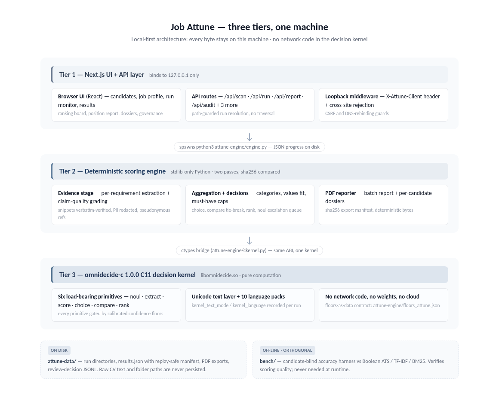
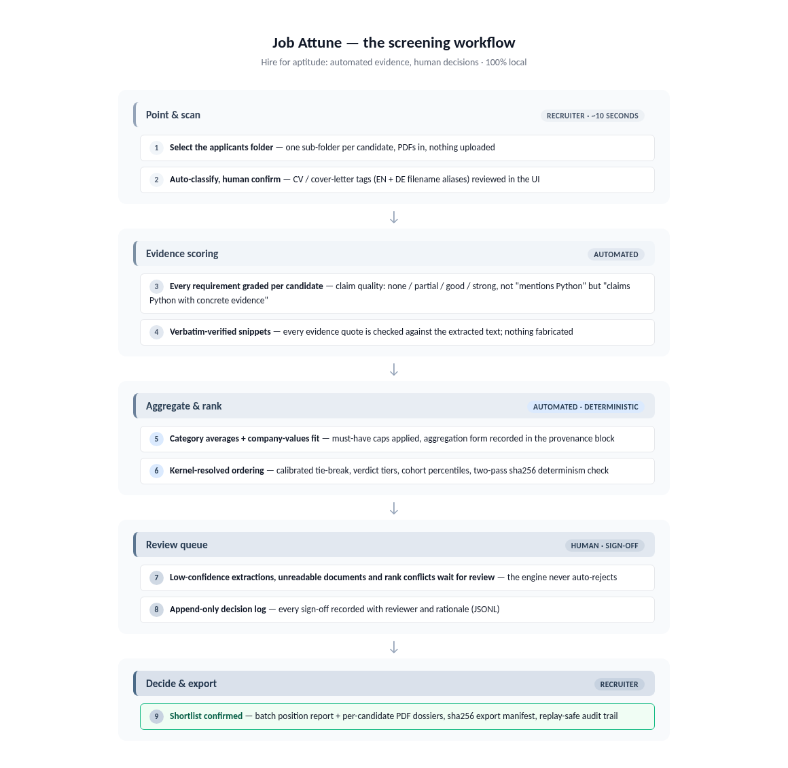

<!-- SPDX-License-Identifier: Apache-2.0 -->
<!-- SPDX-FileCopyrightText: 2026 Tamer Osman -->
# Architecture

Job Attune is a three-tier local application: a Next.js UI + API layer, a
deterministic Python scoring engine, and a frozen decision library. All tiers
run on one machine; no data leaves it. A fourth, orthogonal tier — the
candidate-blind bench harness — verifies scoring quality without ever being
needed at runtime.



```
+--------------------------------------------------------------+
|  Browser (React UI, 7 screens)                               |
|    folder picker -> validation preview -> run monitor ->      |
|    results dashboard -> candidate detail -> review queue ->   |
|    audit                                                      |
+---------------------|----------------------------------------+
                      | fetch (X-Attune-Client header)
+---------------------v----------------------------------------+
|  Next.js API layer (src/app/api, guarded by src/middleware)   |
|    /api/browse  /api/scan  /api/run  /api/run/status          |
|    /api/run/results  /api/report  /api/audit  /api/template   |
|    shared lib: src/lib/attune-server.ts                  |
+-----------|---------------------------------|----------------+
            | filesystem                      | subprocess (python3)
+-----------v-----------------+   +-----------v----------------------+
| attune-data/           |   | attune-engine/engine.py     |
|   runs/<run-id>/...         |<--|   extraction, evidence scoring,  |
|   templates/*.json          |   |   aggregation, ranking, choice,  |
+-----------------------------+   |   noul escalation                |
                                  +-----------|----------------------+
                                              | ctypes bridge (ckernel.py)
                                  +-----------v----------------------+
                                  | vendor/omnidecide-c: C11 kernel |
                                  | (the only kernel,                 |
                                  | libomnidecide.so)                 |
                                  +----------------------------------+
  [offline QA tier]  scripts/check_python_side.py (45 checks)
                     bench/run_bench.py + bench/baselines.py (candidate-blind)
```

## Components

### UI (`src/`)

Seven screens composed from shadcn/ui components. The UI never talks to the
engine directly — it goes through the API layer, which owns every filesystem
and subprocess interaction. Client-side helpers live in
`src/lib/attune.ts` (typed `api()` fetch wrapper that always sends the
client header, scan types, formatting helpers).

### API layer (`src/app/api` + `src/lib/attune-server.ts`)

Thin, defensive request handlers. Responsibilities: input validation (run-id
regex + containment + symlink-realpath guards in `resolveRunDir`), folder
scanning and CV/cover-letter classification, collision-proof run-id creation
(EEXIST-aware mkdir retries), engine/reporter process lifecycle (progress
watchdog, 120 s report timeout), and audit-trail appends with capped
free-text fields.

### Engine (`attune-engine/engine.py`)

Stdlib-only Python. Reads the candidate folder and a job profile JSON, writes
`results.json` + `progress.json` into the run directory. All decision math is
delegated to the decision kernel - **omnidecide-c 1.0.0** (C11, loaded
through the ctypes bridge `attune-engine/ckernel.py`, the only kernel);
the engine maps document evidence into the six
primitives (extract, score, rank, compare, choice, noul) and applies the
calibrated floors contract (`floors_attune.json`, provenance-pinned to
the 1,920-episode calibration dataset, loaded through the vendored floors
contract `attune-engine/floors.py`).

The scoring pipeline inside the engine, stage by stage:

1. **Extraction** — PDF text-layer parsing (pypdf) with per-candidate
   classification into CV vs cover-letter texts (EN + DE filename aliases,
   identical rule set to the TypeScript scanner).
2. **Requirement evidence** — every profile requirement is matched against
   the candidate texts via alias regexes; each hit is graded
   `none / partial / good / strong` by *claim quality* (what the document
   actually claims about the skill, not just that the token appears), and an
   `evidence_score` in [0, 1] is recorded per requirement.
3. **Aggregation** — `aggregate_categories()` folds per-requirement evidence
   into six category averages, then into one `categories_total` score. The
   form is configurable per profile (see below); the default (`uniform`,
   `zero_weight_factor = 1.0`) is byte-identical to the frozen reference
   scoring lineage.
   A must-have cap (0.4) applies when required skills have no credible
   evidence.
4. **Values fit** — company value phrases are matched against the candidate
   corpus with German→English folding, producing the second weighted signal.
5. **Ranking & choice** — final score = `0.85 * categories_total +
   0.15 * values_fit` (weights overridable per profile); the decision
   kernel resolves near-ties deterministically and escalates rank conflicts
   to the review queue (noul primitive).
6. **Provenance** — the run manifest records engine/decision-kernel/floors
   versions, the pseudonymisation salt reference, and the exact aggregation
   configuration used.

### Aggregation framework (opt-in)

Profiles may override the aggregation shape via the `weights` block; unknown
values fail the run rather than silently defaulting:

| Profile key | Values | Meaning |
|---|---|---|
| `weights.category_weighting` | `uniform` *(default)* | unweighted mean of the six category averages (v0 behaviour) |
| | `req_share` | category averages weighted by their share of original requirement weights |
| | `global` | single pooled evidence average, category layer removed |
| `weights.zero_weight_factor` | float in [0, 1] *(default 1.0)* | down-weights requirements whose `evidence_score == 0.0` |

Every `results.json` carries an `aggregation` provenance block (form, factor,
effective weights) so any historical run can be reproduced and audited. The
recalibration grid (18 preregistered variants, frozen plan) measured
**no default change justified** — the shipped defaults are the calibrated
ones; the framework exists so a customer corpus can be tuned *on evidence*,
not on vibes.

### Reporter (`attune-engine/make_report.py`)

ReportLab PDF export: one batch report (17 pages on the demo corpus) plus one
pseudonymous per-candidate dossier each, recorded in
`exports/manifest.json` with sha256 hashes. `rl_config.invariant = 1` makes
output byte-stable across runs and machines.

### Bench harness (`bench/`, offline)

Candidate-blind benchmarking (`bench/run_bench.py`): ranks the same corpus
with the engine and three baselines — Boolean ATS (must-have keyword veto +
coverage), TF-IDF (cosine, sublinear tf, smoothed idf), BM25 (Okapi, k1=1.5
b=0.75). Baseline keywords derive **only** from the job profile, never from
candidate documents. Every cell runs twice per system and records sha256
score projections; a cell ships only if both passes agree. Corpora with a
frozen, pre-registered human ranking (sha256-pinned before any engine run)
produce Spearman rho / MAE / top-3 / bottom-3 overlap against the human
order. See [bench/README.md](../bench/README.md) and
[docs/DEVELOPMENT.md](DEVELOPMENT.md) for the corpus authoring guide.

## Run lifecycle



1. **Scan** — `POST /api/scan` lists candidate sub-folders, finds PDFs and
   classifies each file (CV aliases: resume/cv/lebenslauf/...; cover aliases:
   cover/anschreiben/...). The classifier is duplicated in TypeScript and
   Python with identical alias sets and tie-breaking so the preview the
   recruiter confirms is exactly what the engine sees.
2. **Start** — `POST /api/run` writes `input.json` + `profile.json` into a
   fresh `run-<timestamp>` directory (with a 4-hex collision suffix when the
   second-resolution timestamp is taken), then spawns the engine. Role
   overrides from the validation preview are merged into the profile
   (`role_overrides`), fixing the re-tag contract end-to-end.
3. **Progress** — the engine appends stages to `progress.json` (atomic tmp +
   rename); `GET /api/run/status` reports stage/percent, distinguishes a
   booting engine from a dead one via `input.json` mtime (120 s stale bound),
   and surfaces spawn failures as failed progress.
4. **Results** — `GET /api/run/results` returns `results.json`, the review
   decision log and the export manifest in one payload.
5. **Export** — `POST /api/report` spawns `make_report.py`
   (`--pseudonymous 1` by default), 120 s timeout, and validates the produced
   manifest.
6. **Review / audit** — escalations and sign-offs append to
   `review_decisions.jsonl` via `POST /api/audit`; the file is immutable and
   free-text fields are length-capped.

## Run directory contract

| File | Writer | Contents |
|---|---|---|
| `input.json` | API | scan snapshot: folders, files, roles, overrides |
| `profile.json` | API | job profile + `role_overrides` |
| `progress.json` | engine | `{ progress: { stage, pct, message } }` |
| `results.json` | engine | full dossier set, ranking, aggregation block, manifest |
| `review_decisions.jsonl` | API | append-only human decisions |
| `exports/manifest.json` | reporter | file list + sha256 + engine/omnidecide/floors versions |
| `exports/batch-report.pdf`, `exports/candidate-<ref>.pdf` | reporter | pseudonymous PDFs |

## Determinism

- `REFERENCE_YEAR` is pinned (2026) so "present"-open date ranges resolve
  identically regardless of wall clock; overridable via `--reference-year`
  for replay of historical runs.
- All persisted JSON is canonical (sorted keys, no floating timestamps in
  score paths); two-pass runs hash identically (sha256-checked by the QA
  gate on every change).
- The pseudonymisation salt defaults to the run directory name; `--salt`
  overrides it for cross-run stable references.
- PDFs render with ReportLab invariant mode; the gate verifies 7 exports
  parse and match their manifest hashes.
- Replay discipline: a stored run is reproducible by re-running the engine
  with the same inputs, salt (run-dir name), and `--reference-year`. A purity
  proof reproduced a stored run with 12,316/12,316
  content leaves identical.

## Redaction & pseudonymisation

Raw document text is never persisted (`results.json` carries structured
evidence only — the gate probes for raw emails, phone numbers and local
paths). Candidate identities map to 10-hex refs; near-tie and comparison
details reference candidates by ref, not name. Review-queue details are
scrubbed of folder names (the one channel that could leak employer-side
paths into PDFs). Phone-style numeric sequences are redacted year-aware:
evidence dates survive, phone numbers do not.

## Security model

- **Loopback only**: dev/start scripts bind `127.0.0.1`.
- **No network surface**: the scoring engine is stdlib-only Python and the
  decision kernel is a pure C11 computation library — neither opens sockets
  or makes network calls, so screening runs fully offline.
- **CSRF / drive-by**: `src/middleware.ts` requires the
  `X-Attune-Client` header (cross-site `no-cors` requests cannot set
  custom headers) and rejects `Sec-Fetch-Site: cross-site`.
- **Path traversal**: run ids are regex-validated and resolved with
  containment + realpath checks; template names are allow-list-validated;
  browse/scan accept absolute or root-relative paths but never write.
- **Bounded inputs**: audit free-text fields are capped; oversized exports
  and hung reporter processes are killed by timeout.

## Testing & QA

`scripts/check_python_side.py` is the release gate: 45 checks across static
analysis, floors contract, functional engine behaviour (determinism, ranking
order, primitives load-bearing, escalation, PII probes, enrichment fields,
tuned-evidence overrides, bench baselines C36–C38) and PDF export
validation. JS/TS static health is tracked by the Fallow pipelines in
`scripts/attune_app/js_check_pipelines.py` (release rule: 0 red).
Scoring-lineage protection is the regression lock — three stored
reference-lineage runs replayed against the current engine with an explicit
diff allowlist (see [docs/DEVELOPMENT.md](DEVELOPMENT.md)).
