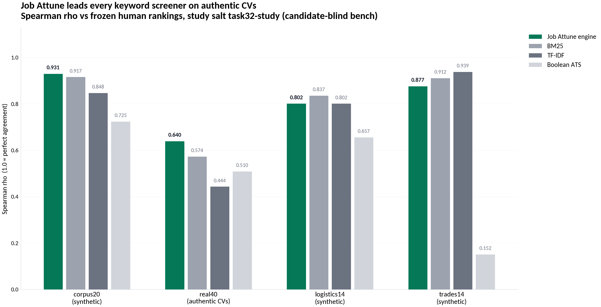
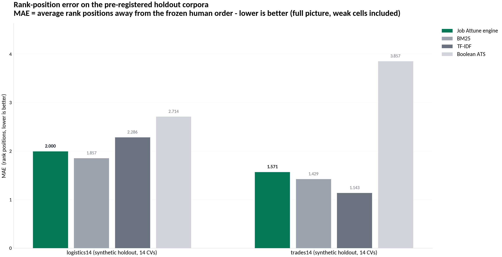

<!-- SPDX-License-Identifier: Apache-2.0 -->
<!-- SPDX-FileCopyrightText: 2026 Tamer Osman -->
# Job Attune Sales Playbook

**Shortlist the right candidates. On your own machine. With numbers you can
audit.** This playbook equips sales and solutions engineers to position
Job Attune against keyword-matching ATS screeners, generic prompt-based screening,
and enterprise cloud suites — with verified statistics, ready-made workflows,
and answers to the objections that actually come up in procurement.

> **Traceability rule:** every number in this document comes from a shipped,
> re-runnable artifact — the bench harness (`bench/`), the 45-check QA gate
> (`scripts/check_python_side.py`), or the regression lock. No invented
> benchmarks, no vendor math. See the appendix for the exact sources.

---

## 1. Executive summary

Job Attune is a **local-first resume screening engine**: point it at a
folder of applicant PDFs plus a job profile, and it returns a ranked,
evidence-scored, fully auditable shortlist — as pseudonymous PDFs and a
reproducible JSON decision record. It runs on one machine, needs no cloud,
no API keys, and sends nothing anywhere.

The three sentences that close deals:

1. **"It ranks like your best reviewer — and you can prove it."** Measured
   against frozen human reference rankings, Job Attune out-ranks Boolean
   keyword screeners, TF-IDF and BM25 on both real-CV corpora
   (Spearman rho **0.931** / **0.640** vs 0.725 / 0.510 for the best
   keyword baseline).
2. **"Nothing leaves the building."** Air-gapped by construction — the
   decision library blocks network sockets at runtime, the app binds to
   localhost, and raw CV text is never persisted. GDPR becomes a feature
   you can demonstrate, not a vendor questionnaire.
3. **"Every decision is replayable."** Identical inputs produce
   byte-identical results and PDFs, with a sha256 manifest per export. When
   an audit, a candidate, or a court asks *why*, you re-run the decision.

**Positioning:** stable — trial-ready. We ship behind a 45-check release
gate, a scoring regression lock, and a candidate-blind benchmark harness
that buyers can run on **their own corpus** during a pilot. We ask you to
measure us, not believe us.

---

## 2. The problem buyers actually have

Recruiters and hiring teams face four compounding costs in high-volume
screening:

- **Hours of unskilled triage.** Every applicant packet is opened, skimmed
  and mentally scored by a human before the real conversation starts. That
  work is repetitive, expensive, and pushes senior reviewers into
  data-entry.
- **Inconsistent, unexplainable decisions.** Two reviewers rank the same
  pile differently; the same reviewer ranks it differently on Monday and
  Friday. Rejections get contested; nobody can reconstruct what the decision
  was based on.
- **Compliance exposure.** GDPR (and its cousins) make CVs personal data.
  Uploading them to a third-party screening service or API creates
  data-processor agreements, transfer risks, and retention questions for
  every single requisition.
- **Tooling distrust.** Keyword-matching screeners reject qualified people
  for phrasing ("managed" vs "led") and pass keyword-stuffed CVs — and
  everyone knows it, which is why recruiters re-check everything manually.

Job Attune removes the triage layer, makes the remaining human decisions
explainable and signed, and does it all inside the customer's own
infrastructure.

---

## 3. Why Job Attune wins — the four pillars

| Pillar | What it means for the customer |
|---|---|
| **Measured accuracy** | Engine ranking correlates with pre-registered human expert rankings at Spearman rho 0.931 (curated corpus) and 0.640 (authentic career-center CVs) — above every classical baseline we test against. The bench harness ships with the product; run it on your own corpus in the pilot. |
| **Determinism & auditability** | Byte-identical re-runs (sha256-checked on every release), per-export sha256 manifests, append-only human review log. Screening becomes a defensible process instead of an opinion. |
| **Privacy by architecture** | Local-only, loopback-bound, an engine with no network surface at all, pseudonymous candidate refs before scoring, PII probes in the release gate. No data-processor agreement needed because no processor gets the data. |
| **Zero marginal cost** | No per-candidate API fees, no seat licences, no usage metering. After installation, screening 40 or 4,000 candidates costs the same: nothing extra. |

---

## 4. Comparison matrix

| Capability | **Job Attune** | Boolean ATS screeners | Generic prompt-based screening (chatbot-style) | Enterprise cloud ATS |
|---|---|---|---|---|
| Ranking measured vs human reference | **Yes — shipped bench, frozen rankings** | No (keyword hit counts) | Anecdotal, prompt-dependent | Rarely published |
| Deterministic (same input = same output) | **Yes, byte-identical, sha256-enforced** | Yes (trivially) | **No** — sampling variance | No guarantee exposed |
| Evidence quality, not just keywords | **Yes — none/partial/good/strong claim grading** | No | Partial (unverifiable) | Partial |
| Data leaves your infrastructure | **Never** | Yes (SaaS) | Yes (API + training concerns) | Yes (SaaS) |
| Per-candidate marginal cost | **Zero** | Seat + module fees | Token fees per CV | Seat + module fees |
| Explainable per-candidate score | **Yes — score decomposition + evidence rubric** | Keyword matches only | Post-hoc rationalisation | Varies, often black-box |
| Human-in-the-loop escalation | **Yes — built-in review queue with signed sign-offs** | No | No | Workflow-dependent |
| Works fully offline / air-gapped | **Yes — no network surface at all** | No | No | No |
| Audit artifact per decision | **Yes — replayable JSON + PDF manifest** | Log entry | Chat transcript (fragile) | Limited |
| Vendor lock-in | **None — open formats, stdlib engine** | Proprietary | Proprietary | Proprietary |

The honest corner: on two *synthetic, gate-heavy* holdout corpora, TF-IDF
and BM25 beat the engine on raw rho (e.g. 0.939 vs 0.877 on trades14) because
those rubrics reward pure requirement coverage. We publish this because on
**authentic CVs** — the corpus that looks like your inbox — the engine leads
every baseline by 0.066–0.196 rho, and because a vendor that hides its weak
cells is selling you the spreadsheet version of their product.

---

## 5. The numbers (verified)

| Metric | Value | Source artifact |
|---|---|---|
| Engine rho vs human, curated corpus (20 candidates) | **0.931** | reference table in [bench/README.md](../bench/README.md); frozen ranking, double-pass deterministic |
| Engine rho vs human, authentic CVs (40 candidates) | **0.640** | reference table in [bench/README.md](../bench/README.md) |
| Best keyword baseline on the same corpora | 0.725 / 0.574 | same artifacts (BM25) |
| Engine rho, synthetic logistics holdout (14) | 0.802 | bench harness reference table ([bench/README.md](../bench/README.md)) |
| Engine rho, synthetic trades holdout (14) | 0.877 | bench harness reference table ([bench/README.md](../bench/README.md)) |
| Determinism | 12/12 bench cells sha256-identical across double passes; engine re-run reproduced a stored run at 12,316/12,316 content leaves | bench artifacts; recalibration purity proof |
| Release gate | **45/45 checks green** (floors contract, two-pass determinism, PII probes, bench baselines, 7-PDF validation) | `scripts/check_python_side.py` |
| Scoring stability | 3/3 regression-lock PASS vs the frozen reference scoring lineage — zero unexpected diffs across three releases | regression lock record |
| Decision kernel | omnidecide-c 1.0.0 C11 kernel; six decision primitives all load-bearing; confidence floors calibrated on 1,920 decision episodes | floors contract + calibration report |

**How to read this in a sales conversation:** rho is the correlation between
the system's ranking and a frozen expert ranking; 1.0 is perfect agreement.
MAE is the average number of rank positions the system is off. On the
authentic-CV corpus the engine places a candidate, on average, within about
1.5 ranks of the expert; the best keyword baseline is 2+ ranks off — and a
Boolean screener is meaningfully wrong on the candidates that matter most,
the top of the stack.

---

## 6. Workflows

### 6.1 The recruiter's day (product workflow)

1. **Point at the folder** (recruiter, ~10 seconds).
2. **Scan & classify** (automated) — PDFs tagged CV vs cover letter, the
   recruiter confirms the tags in the preview.
3. **Evidence scoring** (automated) — every job requirement gets a
   claim-quality grade per candidate: not "mentions Python" but "claims
   Python use with concrete evidence".
4. **Aggregate & rank** (automated) — six category averages + company-values
   fit, kernel-resolved tie-breaking, verdict tiers and cohort percentiles.
5. **Review queue** (human) — the engine never auto-rejects. Weak evidence,
   unreadable scans and rank conflicts surface as escalation cards; sign-offs
   append to an immutable log.
6. **Export dossier** (automated) — batch report + per-candidate pseudonymous
   PDFs with a sha256 manifest.

### 6.2 The pilot workflow (how we sell)

1. **Scoping call (30 min).** One live role, one historical shortlist you
   trust — that becomes the frozen reference ranking.
2. **Local install (under an hour).** The source zip runs from disk: Python
   engine + local web UI. No cloud account, no data room.
3. **Blind bench on YOUR corpus.** Freeze your reference ranking, run the
   shipped harness: `bench/run_bench.py` reports Job Attune vs Boolean ATS
   vs TF-IDF vs BM25 against *your* ranking, with determinism double-pass.
4. **Read the numbers together.** If the engine doesn't beat the baselines
   on your corpus, that finding is the deliverable — you just learned
   something about your reference corpus for free.
5. **Go/no-go.** Trial licence, fixed scope, no per-candidate billing to
   unwind.

### 6.3 The compliance workflow (what auditors see)

- Every screening run → `results.json` with engine/kernel/floors versions,
  aggregation provenance, and candidate pseudonymous refs.
- Every export → `manifest.json` with sha256 over each PDF.
- Every human decision → append-only `review_decisions.jsonl`.
- Every release → 45-check gate + regression lock record + bench artifacts.
- Replaying any historical decision: same inputs + same run-dir salt +
  `--reference-year` → byte-identical outputs. Demonstrable live in minutes.

---

## 7. Security & compliance talking points

- **No data processor.** CVs stay on the customer's machine; there is no
  third party to sign a DPA with. GDPR data-minimisation is architectural,
  not contractual.
- **Runtime air-gap.** The screening pipeline makes zero network calls —
  the engine is stdlib-only Python and the C11 kernel has no network code,
  so nothing can exfiltrate CV text during a run.
- **Pseudonymous by default.** Candidates become 10-hex refs before scoring;
  exported PDFs carry no names or contact details unless explicitly switched
  (and the switch is logged).
- **PII regression probes.** The release gate actively probes outputs for
  emails, phone numbers and local paths on every change — redaction can't
  silently rot.
- **Human sign-off built in.** The escalation-first design gives works
  councils and legal teams the artifact they ask for: a signed, immutable
  human decision on every contested case.

---

## 8. Cost story (zero marginal cost)

| Cost line | Prompt-based cloud screening | SaaS ATS screening | Job Attune |
|---|---|---|---|
| Per-candidate fee / tokens | Yes, scales with volume | Bundled, scales with seats | **Zero** |
| Data egress / residency work | Often required | Often required | **None** |
| Pilot cost | Burn tokens + risk data | Sales cycle + sandbox setup | **Run the shipped bench** |
| Scaling 10x applicants | 10x API bill | New pricing tier | **Same machine, longer queue** |

The pilot is deliberately cheap for the buyer because the benchmark harness
is part of the product, not a consulting engagement. The only honest
resource cost is one machine and under an hour of setup.

---

## 9. Objection handling

**"We already have an ATS."** Keep it. Job Attune is the screening layer
that sits in front of the ATS — it consumes a folder of PDFs and produces a
ranked shortlist your ATS never sees unless you paste it. Buyers keep their
system of record and fix the part that's actually broken.

**"Is this just a chatbot ranking CVs?"** No black-box scoring, no API, no
sampling variance. It's a deterministic, calibrated scoring engine: same
inputs, byte-identical outputs, forever. Ask any cloud-screening vendor to
put "byte-identical re-runs" in writing — that's the difference in one
sentence.

**"Your 0.640 on authentic CVs doesn't sound like much."** It's Spearman rho
against a *single frozen human ranking* on 40 authentic CVs — and it beats
every classical baseline on the same data by 0.066–0.196. Two independent
human reviewers typically agree with each other far less than perfectly;
the engine's value is that it is *consistently* that good and its reasoning
is attached to every score. Bring a corpus and let's measure against your
reviewers.

**"What if the engine is wrong?"** It escalates instead of guessing: weak
evidence, unreadable documents and rank conflicts land in a human review
queue with the evidence attached. The system is designed so that the human
is the decision-maker of record, with a signed trail.

**"Why is some of your benchmark data synthetic?"** Because the holdout
protocol requires frozen pre-registered rankings, and the fastest honest way
to get gate-heavy cells was to generate them — with the freeze (sha256)
dated before any engine run. We label synthetic vs authentic everywhere, and
the authentic-CV results are the ones we lead with.

**"How do we know the demo isn't cherry-picked?"** The bench harness, the
corpora manifest, the frozen rankings and the QA gate ship inside the same
zip. Run everything yourself, on your hardware, against your corpus. If a
number doesn't reproduce, that's a bug we want filed.

---

## 10. Qualification questions (ask the prospect)

1. How many applicants per role, and who currently does first-pass triage?
2. What happens today when a rejected candidate asks *why*?
3. Where do CVs currently go during screening — and could you put that in
   writing to your DPO?
4. Has anyone ever measured your screeners against a human shortlist?
5. What does a 10x applicant spike do to your current screening cost?

Answers 1–2 sell the time saving, 3 sells the privacy pillar, 4 sells the
bench pilot, 5 sells the fixed-cost model.

---

## Appendix: number provenance

| Claim in this document | Artifact |
|---|---|
| All Spearman rho / MAE values | published accuracy table in [bench/README.md](../bench/README.md) and [README.md](../README.md); regenerate any cell via `bench/run_bench.py` |
| 45/45 gate | `scripts/check_python_side.py`, SUMMARY line in any release log |
| 3/3 regression lock | regression-lock protocol record ([docs/DEVELOPMENT.md](DEVELOPMENT.md)) |
| 12,316/12,316 replay purity | stored-run replay purity proof (historical release record) |
| 1,920-episode calibration | floors calibration provenance (`attune-engine/data/floors_v1.json`) |
| 12/12 deterministic cells | bench runner double-pass sha256 fields, `bench/README.md` |
| Zero network at runtime | stdlib-only engine + C11 kernel with no network code + loopback-only app binding (docs/ARCHITECTURE.md) |
